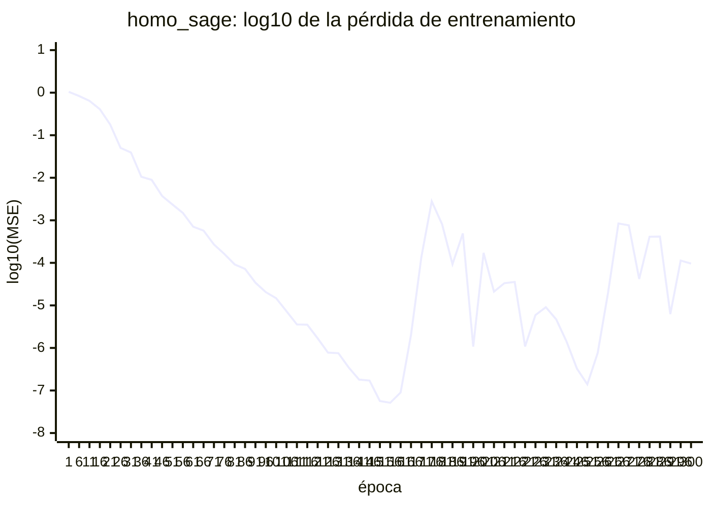
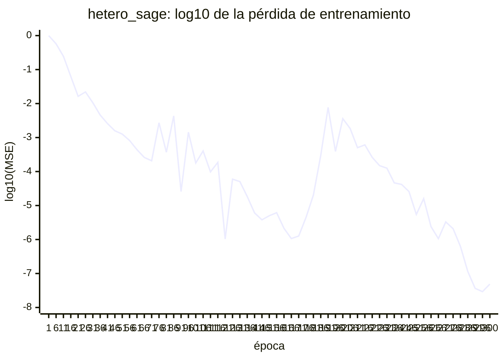
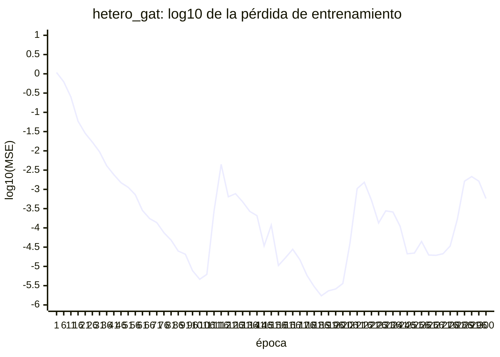

# Prueba de sobreajuste de las GNN (A41-7)

Prueba de cordura previa al pipeline de entrenamiento (act. 44): cada variante debe poder
llevar a casi cero la pérdida de entrenamiento sobre un mismo lote pequeño. Si una variante no lo
logra, el defecto es de construcción (gradientes que no llegan, capas sin efecto, escalas que
impiden optimizar), no de falta de datos. Pasarla **no** dice nada sobre generalización.

La lógica está en `nutrigraphdt.models.gnn.sanity` y el experimento en `scripts/overfit_gnn.py`;
`tests/integration/test_gnn_overfit.py` lo ejecuta con un lote y épocas reducidos. Requiere el
extra `graph`.

```bash
python scripts/overfit_gnn.py
```

## Protocolo

- **Lote.** `--n-graphs` grafos sintéticos (8 por defecto) de semillas consecutivas desde
  `--first-seed`, cada uno convertido con `build_synthetic_graphs` (compuerta de VG-07), con
  relaciones inversas (`add_reverse_edges`) y target por grafo (`add_graph_target`). Los 8
  grafos tienen los tres AGCC.
- **Escalado.** Features por tipo y columna y target por AGCC, con las estadísticas del propio
  lote (`prepare_overfit_batch`). Aquí el lote es el conjunto de entrenamiento, así que no hay
  fuga; no reemplaza el escalado del pipeline (A44-2, #96), que ajusta con `train`.
- **Modelos.** `ModelConfig(dropout=0.0)`: `hidden_channels = 64` y `num_layers = 2` del §6 del
  [diseño](gnn-architecture.md), sin dropout para que la pérdida refleje solo la capacidad de
  ajuste. Agregaciones y cabezas con sus valores iniciales. `torch.manual_seed(42)` antes de
  construir cada variante.
- **Optimización.** Adam con `lr = 1e-3` (§6), 300 pasos completos sobre el mismo lote, pérdida
  `masked_mse_loss` en la escala estandarizada.
- **Criterio.** Pérdida final menor que `--threshold` (`1e-2` por defecto): con el target
  estandarizado, la varianza de partida es 1, así que el umbral es el 1 % de esa varianza.

## Resultado

Comando `python scripts/overfit_gnn.py` (valores por defecto). Python 3.14.6, torch 2.14.0+cpu,
torch-geometric 2.8.0. Grafos `synthetic:graph:0001` a `synthetic:graph:0008`, alineados con
`align_graph_types` (#119) antes de agruparlos.

| Variante | Pérdida inicial | Pérdida final (época 300) | Mínima | ¿Sobreajusta? |
|---|---:|---:|---:|---|
| `homo_sage` | 1.0477 | 9.60e-05 | 1.49e-08 | sí |
| `hetero_sage` | 0.9983 | 4.88e-08 | 6.64e-09 | sí |
| `hetero_gat` | 1.0822 | 5.80e-04 | 6.03e-08 | sí |

Las tres variantes sobreajustan el lote, así que no hace falta abrir un issue de corrección.

Las tres bajan de 1e-3 entre las épocas 50 y 58. Después hay picos aislados, típicos de Adam con
`lr` fijo y una pérdida muy cercana a cero, y la pérdida se recupera de ellos:

| Variante | Primera época < 1e-3 | Pico máximo posterior | Épocas posteriores > 1e-3 |
|---|---:|---:|---:|
| `homo_sage` | 58 | 3.48e-03 | 13 |
| `hetero_sage` | 52 | 1.54e-02 | 35 |
| `hetero_gat` | 50 | 5.26e-03 | 28 |

El pico de `hetero_sage` supera por un momento el umbral. El criterio usa la pérdida de la
última época, que queda muy por debajo. El entrenamiento real (A44-3, #97) conserva la mejor
época según `val`, no la última.

Hasta #119, el lote mezclaba aristas entre grafos cuando no todos tenían las mismas relaciones,
así que las cifras anteriores no son comparables con estas.

Curvas (`log10` de la pérdida; una de cada cinco épocas y la última):






