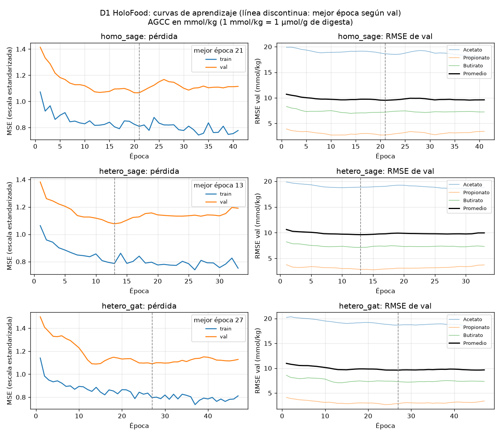
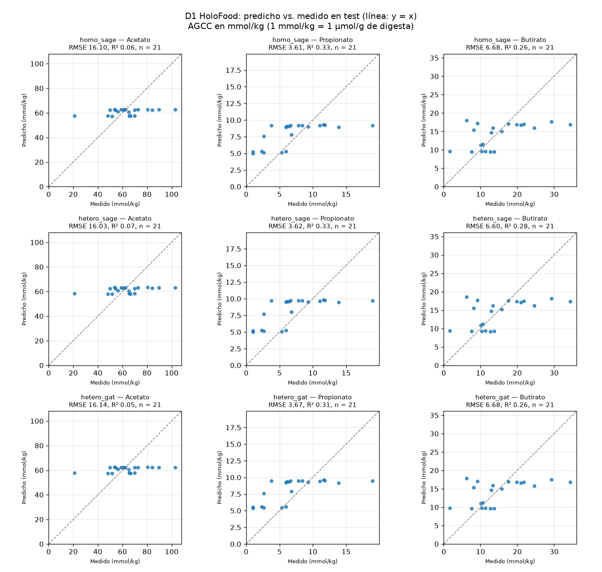

# Curvas de aprendizaje y predicciones — D1 HoloFood (A45-7)

Generado con `python scripts/plot_gnn_runs.py <corridas>` a partir de corridas registradas, sin reentrenar. AGCC en mmol/kg (1 mmol/kg = 1 µmol/g de digesta). La interpretación está en `docs/models/gnn-evaluation.md`.

## Corridas

| Variante | `run_id` | Semilla | Commit | Dirty | Partición (SHA-256) |
| :--- | :--- | ---: | :--- | :--- | :--- |
| `homo_sage` | `20261015-182656_homo_sage_s42` | 42 | `6595cc1` | no | `b6dd7d157d34…` |
| `hetero_sage` | `20261015-183900_hetero_sage_s42` | 42 | `6595cc1` | no | `b6dd7d157d34…` |
| `hetero_gat` | `20261015-184535_hetero_gat_s42` | 42 | `6595cc1` | no | `b6dd7d157d34…` |

## Diagnóstico

Pérdidas en la escala estandarizada del target; RMSE en mmol/kg. `test`: dispersión = desviación estándar predicha / medida.

| Variante | Mejor época / corridas | Pérdida train (mejor → última) | Pérdida val (mejor → última) | RMSE val (época 1 → mejor) | RMSE test | R² test |
| :--- | ---: | ---: | ---: | ---: | ---: | ---: |
| `homo_sage` | 21 / 41 | 0.809 → 0.777 | 1.066 → 1.115 | 10.71 → 9.52 | 8.80 | 0.22 |
| `hetero_sage` | 13 / 33 | 0.786 → 0.752 | 1.076 → 1.191 | 10.62 → 9.61 | 8.75 | 0.22 |
| `hetero_gat` | 27 / 47 | 0.796 → 0.811 | 1.090 → 1.128 | 10.97 → 9.61 | 8.83 | 0.21 |

| Variante | Dispersión acetato | Dispersión propionato | Dispersión butirato | r acetato | r propionato | r butirato |
| :--- | ---: | ---: | ---: | ---: | ---: | ---: |
| `homo_sage` | 0.13 | 0.40 | 0.42 | 0.41 | 0.65 | 0.53 |
| `hetero_sage` | 0.13 | 0.45 | 0.46 | 0.43 | 0.65 | 0.54 |
| `hetero_gat` | 0.13 | 0.39 | 0.41 | 0.42 | 0.65 | 0.54 |
