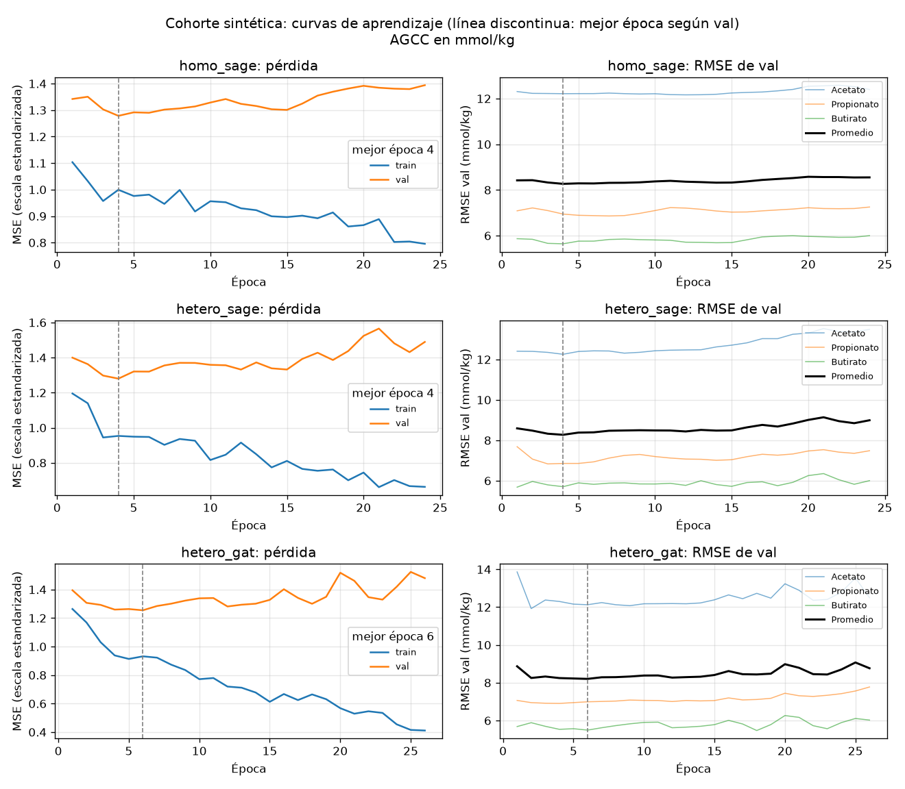
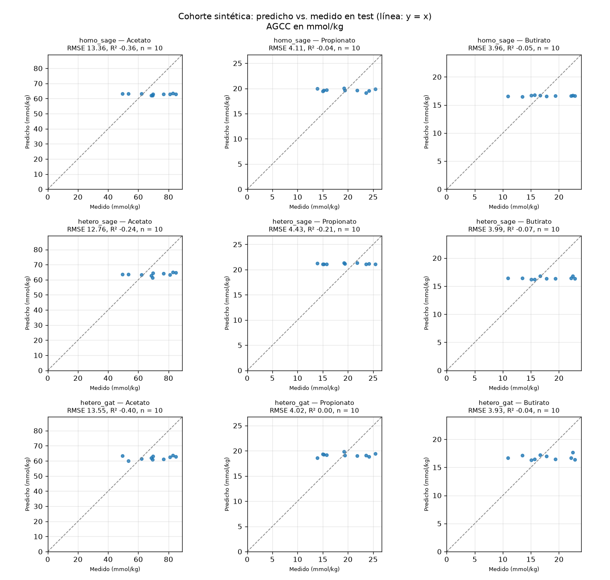

# Curvas de aprendizaje y predicciones — Cohorte sintética (A45-7)

Generado con `python scripts/plot_gnn_runs.py <corridas>` a partir de corridas registradas, sin reentrenar. AGCC en mmol/kg. La interpretación está en `docs/models/gnn-evaluation.md`.

## Corridas

| Variante | `run_id` | Semilla | Commit | Dirty | Partición (SHA-256) |
| :--- | :--- | ---: | :--- | :--- | :--- |
| `homo_sage` | `20261015-174250_homo_sage_s42` | 42 | `6595cc1` | no | `dab88b885512…` |
| `hetero_sage` | `20261015-174321_hetero_sage_s42` | 42 | `6595cc1` | no | `dab88b885512…` |
| `hetero_gat` | `20261015-174208_hetero_gat_s42` | 42 | `6595cc1` | no | `dab88b885512…` |

## Diagnóstico

Pérdidas en la escala estandarizada del target; RMSE en mmol/kg. `test`: dispersión = desviación estándar predicha / medida.

| Variante | Mejor época / corridas | Pérdida train (mejor → última) | Pérdida val (mejor → última) | RMSE val (época 1 → mejor) | RMSE test | R² test |
| :--- | ---: | ---: | ---: | ---: | ---: | ---: |
| `homo_sage` | 4 / 24 | 0.999 → 0.796 | 1.278 → 1.394 | 8.42 → 8.27 | 7.14 | -0.15 |
| `hetero_sage` | 4 / 24 | 0.953 → 0.663 | 1.280 → 1.489 | 8.59 → 8.27 | 7.06 | -0.17 |
| `hetero_gat` | 6 / 26 | 0.932 → 0.411 | 1.255 → 1.480 | 8.87 → 8.20 | 7.17 | -0.14 |

| Variante | Dispersión acetato | Dispersión propionato | Dispersión butirato | r acetato | r propionato | r butirato |
| :--- | ---: | ---: | ---: | ---: | ---: | ---: |
| `homo_sage` | 0.04 | 0.06 | 0.02 | 0.09 | -0.25 | 0.30 |
| `hetero_sage` | 0.09 | 0.02 | 0.05 | 0.34 | -0.02 | 0.29 |
| `hetero_gat` | 0.10 | 0.08 | 0.11 | 0.34 | 0.06 | 0.10 |
